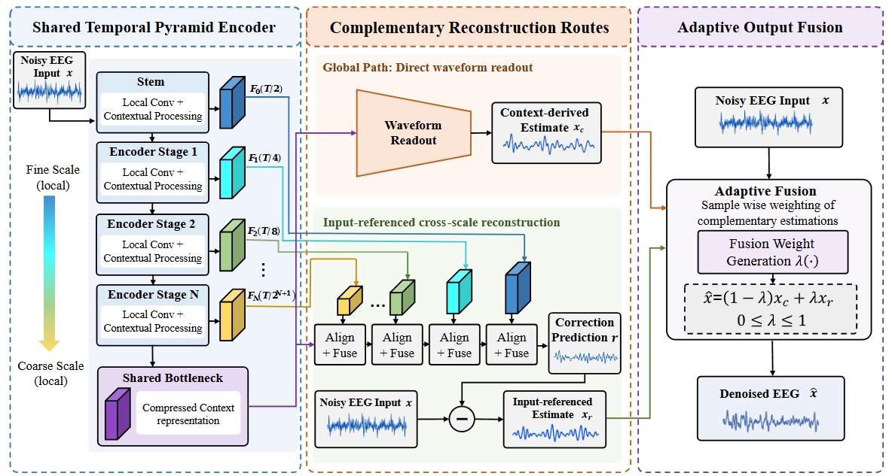
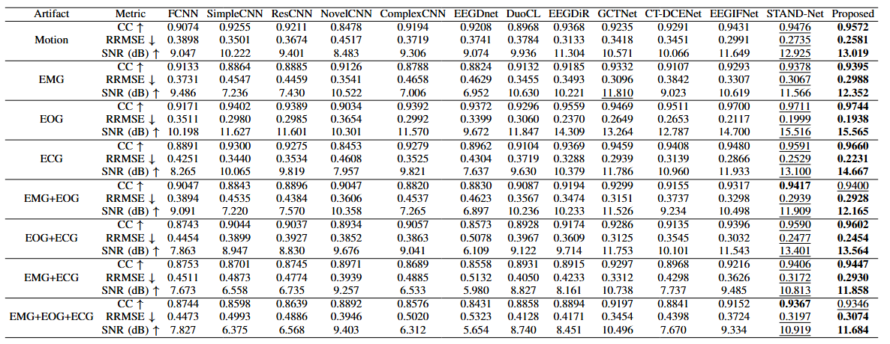

# TCCR-Net

**Efficient EEG Denoising via Compressed Context Modeling and Complementary Reconstruction**

TCCR-Net removes artifacts from single-channel EEG through compressed context
modeling and complementary reconstruction. It combines a shared temporal pyramid
encoder, two reconstruction routes, and adaptive output fusion.

## Architecture



1. A convolutional stem downsamples the input by two.
2. Five stages fuse local convolution and temporal attention paths, giving
   total temporal compression of 64 (512 samples become 8 latent frames).
3. A learned complex-pole resonant block supplies latent temporal context.
4. A global readout synthesizes a clean waveform; a multiscale decoder uses
   gated skip features to estimate the artifact residual.
5. A sample-wise router mixes the global and residual-based clean estimates.

## Results



Comparison across single-artifact and mixed-artifact conditions. Higher CC and
SNR, and lower RRMSE, indicate better reconstruction. **Proposed** denotes TCCR-Net.

## Model configuration

The default configuration matches the architecture of the historical ECG
GGLP-ANN model now presented as TCCR-Net: **3,135,270 parameters**, 512 samples,
256 Hz, base width 8, context width 32, five pyramid stages, and a gated-fusion
decoder. `spiking=True` enables the optional event/spiking implementation
(3,135,302 parameters with these widths). The two modes have distinct weights
and dynamics; they are not interchangeable checkpoints.

## Installation

Use Python 3.9 or newer and install a PyTorch build suitable for your platform.
Then, from the repository root:

```bash
python -m pip install .
python examples/forward.py
python -m unittest discover -s tests -v
```

The example runs on CPU and needs no dataset, GPU, or checkpoint.

## Usage

```python
import torch
from tccrnet import TCCRNet

model = TCCRNet().eval()
noisy = torch.randn(2, 1, 512)  # [batch, channel, samples]
with torch.inference_mode():
    denoised, stats = model(noisy)
print(denoised.shape)  # torch.Size([2, 512])

# Optional spiking mode:
event_model = TCCRNet(spiking=True)
```

Inputs may have shape `[B, T]` or `[B, 1, T]`; output is always `[B, T]`.
`T` must equal the configured `signal_length`, which must be divisible by 64.
The network processes one channel at a time and is not a streaming/causal model.
`sample_rate` sets the latent resonator initialization; it does not resample
input data. No filtering or amplitude normalization is applied by the model.
Actual EEG preprocessing must agree with the training recipe of the weights.

`stats` contains gate and resonator diagnostics. In analog mode, the historical
`mean_rate`/`block_0_spikes` keys summarize analog activity, not binary spikes
or measured hardware energy. Recurrent states reset on each forward call.

## Configuration and weights

`configs/ecg_ann.json` records the default model configuration. `model.config()`
returns constructor arguments, and state-dict names are preserved from the
research implementation. For weights saved with this package:

```python
torch.save(model.state_dict(), "weights.pt")
restored = TCCRNet(**model.config())
restored.load_state_dict(
    torch.load("weights.pt", map_location="cpu", weights_only=True), strict=True
)
restored.eval()
```

## Scope and provenance

Random initialization does not yield useful denoising.
Pretrained weights, datasets, the full training pipeline,
baseline code, and paper-result reproduction are not included in this version.
Historical formal training used staged initialization; instantiating this model
does not reproduce that training chain or establish teacher-free training.

The implementation was extracted from the frozen source used by the original
2026-10-17 ECG campaign. Model equations and parameter names are retained;
unrelated research models were removed. `SOURCE_MANIFEST.json` records source
hashes, retained symbols, and packaged file hashes. `TCCRNet` is a thin public
entry point with the formal defaults; the historical `PyramidEventDenoiser`
class name is retained internally for traceability.

Released under the [MIT License](LICENSE).

## 中文说明

TCCR-Net 面向单通道脑电伪迹去除，结合共享时序金字塔编码、互补重建路径和自适应
输出融合。上方展示网络结构与单伪迹、混合伪迹条件下的结果。默认配置与当前正式
展示采用的 ECG 模型架构一致，设置 `spiking=True` 可启用脉冲模式。
